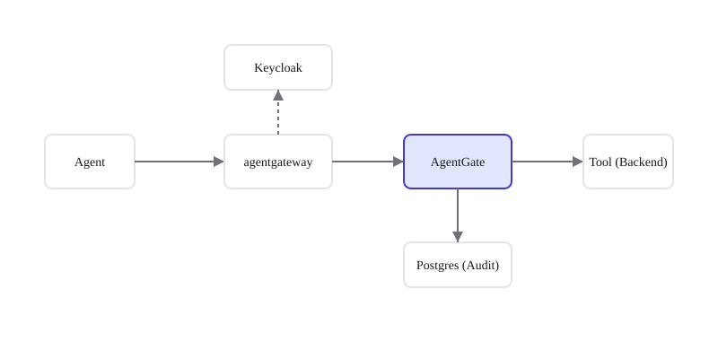

# AgentGate


[](https://github.com/rushi-dynmsh/agentgate-dev/actions/workflows/ci.yml)


**A checkpoint in the only path between an AI agent and its tools.**



## What you get
- **Cryptographic Audit Log**: Append-only PostgreSQL audit events with SHA-256 row chaining.
- **Tool Catalog Governance**: Canonical SHA-256 schema fingerprinting and argument whitelist registry.
- **Ephemeral Credentials**: Mints RS256-signed JWTs with 60-second expiration per tool call.
- **Policy Enforcement**: Integrates Cedar policy engine with dry-run and atomic rollback capabilities.
- **Fail-Closed Architecture**: Any failure in policy, schema, or audit immediately results in a DENY.

## Status
**v1.0.0-rc:** no known critical or high defects found by the 17-scenario live gate, which passed 3 consecutive from-scratch runs in the Docker sandbox on 2026-10-09; known limitations are listed in the runbook; GitHub CI has not run.

## Quickstart (5-minute Demo)
Want to see it in action? See the [Quickstart Guide](website/docs/quickstart.md) or run the one-command demo mode:
```ash
./deploy/prod/scripts/demo-mode.ps1
```

## Documentation
- [Known Limitations](docs/OPERATIONS/RUNBOOK.md#known-v1-limitations)
- [Contributor Documentation](docs/DEVELOPMENT/)

## Licence
To be decided.

