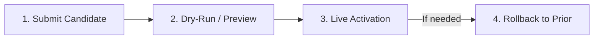

# AgentGate v1 Production Operator Runbook

This runbook is the authoritative operational guide for deploying, managing, securing, and troubleshooting AgentGate in a production environment. All commands in this document are tested against the production Docker Compose topology in `deploy/prod/`.

---

## 1. Prerequisites

Ensure the following tools are installed on the deployment host before starting operations:

| Tool | Minimum Version | Verification Command |
|---|---|---|
| **Docker Engine** | 26.0+ | `docker --version` |
| **Docker Compose** | v2.24+ | `docker compose version` |
| **OpenSSL** | 3.0+ | `openssl version` |
| **PowerShell Core (`pwsh`)** | 7.4+ | `pwsh --version` |
| **cURL** | 8.0+ | `curl --version` |
| **jq** | 1.6+ | `jq --version` |

Verify all prerequisites with:
```bash
docker --version && docker compose version && openssl version && pwsh --version && curl --version | head -n 1 && jq --version
```

---

## 2. First Deploy

### Step 2.1: Initialize Production Secrets and Certificates

AgentGate production enforces strict zero-default credentials and mTLS encryption. Generate cryptographically strong random passwords, internal CA certificates, server certificates with Subject Alternative Names (SANs), mTLS client certificates, RSA signing keys, and `.env`:

```bash
pwsh deploy/prod/scripts/init-secrets.ps1
```

This generates:
- Database, admin, and client passwords in `deploy/prod/secrets/` (`0644` permissions for container user access).
- 4096-bit internal Certificate Authority (`ca.crt`, `ca.key`).
- 2048-bit server certificates (`agentgate.crt`, `agentgateway.crt`, `keycloak.crt`, `admin-ui.crt`).
- 2048-bit mTLS client certificates for Envoy `ext_authz` (`client.crt`, `client.key`).
- 2048-bit RSA downstream credential signing key (`cred_key.pem`).
- Tailored `deploy/prod/.env` populated from `deploy/prod/.env.example`.

### Step 2.2: Review Configuration

Inspect `deploy/prod/.env` to confirm network hostnames and ports:
```bash
cat deploy/prod/.env
```

Key environment settings:
- `AGENTGATE_ENV=production`: Enables strict fail-closed enforcement, production mTLS, and disables debug logging.
- `KC_HOSTNAME=https://keycloak:8443`: Canonical hostname for OIDC token issuance.
- `AGENTGATE_UI_API_URL=https://localhost:9443`: Admin API endpoint reachable by the Admin UI browser client.
- `AGENTGATE_UI_OIDC_AUTHORITY=https://localhost:8443/realms/agentgate`: Keycloak realm URL.

### Step 2.3: Start Production Topology

Deploy all services:
```bash
docker compose -f deploy/prod/docker-compose.yml up -d --build
```

Monitor service startup until all containers report `healthy`:
```bash
docker compose -f deploy/prod/docker-compose.yml ps
```

Expected running containers:
- `prod-postgres` (healthy)
- `prod-keycloak` (healthy)
- `prod-migrate` (completed successfully, exits 0)
- `prod-agentgate` (healthy)
- `prod-agentgateway` (up)
- `prod-support-desk-mcp` (up)
- `prod-admin-ui` (up)

### Step 2.4: Health & Readiness Verification

Run HTTP health probes against all external endpoints:

```bash
# 1. AgentGate Admin & Health API (:9443)
curl -k -s https://localhost:9443/healthz
# Expected output: ok

curl -k -s https://localhost:9443/readyz
# Expected output: ready

# 2. Keycloak OIDC Discovery (:8443)
curl -k -s -o /dev/null -w "%{http_code}\n" https://localhost:8443/realms/agentgate/.well-known/openid-configuration
# Expected output: 200

# 3. Admin UI Web Dashboard (:8444)
curl -k -s -o /dev/null -w "%{http_code}\n" https://localhost:8444/
# Expected output: 200

# 4. AgentGateway Envoy Proxy (:3443)
curl -k -s -o /dev/null -w "%{http_code}\n" https://localhost:3443/
# Expected output: 401 (unauthenticated request rejected by JWT filter)
```

---

## 3. Admin First Login & Password Change

### Option A: Admin UI Dashboard (Browser)
1. Open `https://localhost:8444` in your browser (accept the internal CA self-signed TLS warning if CA is not in system truststore).
2. Click **Sign In** to redirect to Keycloak.
3. Username: `admin`
4. Password: Read from `deploy/prod/secrets/admin_initial_password` or `deploy/prod/.env`:
   ```bash
   grep ADMIN_INITIAL_PASSWORD deploy/prod/.env | cut -d= -f2
   ```
5. You are redirected back to the AgentGate Dashboard with administrative permissions (`agentgate-admin` role).

### Option B: CLI Direct Access Grant (Headless / Automated)
Acquire an admin access token using the password grant on the `agentgate-ops-cli` client:

```bash
ADMIN_PASSWORD=$(grep ADMIN_INITIAL_PASSWORD deploy/prod/.env | cut -d= -f2)
OPS_CLI_SECRET=$(grep OPS_CLI_CLIENT_SECRET deploy/prod/.env | cut -d= -f2)

ADMIN_TOKEN=$(curl -k -s --http1.1 https://localhost:8443/realms/agentgate/protocol/openid-connect/token \
  -d "grant_type=password" \
  -d "client_id=agentgate-ops-cli" \
  -d "client_secret=${OPS_CLI_SECRET}" \
  -d "username=admin" \
  -d "password=${ADMIN_PASSWORD}" | jq -r .access_token)

echo "Admin Token: ${ADMIN_TOKEN:0:30}..."
```

### Password Change via Keycloak Admin API
To change the admin password programmatically:

```bash
KC_ADMIN_PW=$(grep KEYCLOAK_ADMIN_PASSWORD deploy/prod/.env | cut -d= -f2)

KC_ADMIN_TOKEN=$(curl -k -s --http1.1 https://localhost:8443/realms/master/protocol/openid-connect/token \
  -d "grant_type=password" \
  -d "client_id=admin-cli" \
  -d "username=admin" \
  -d "password=${KC_ADMIN_PW}" | jq -r .access_token)

ADMIN_USER_ID=$(curl -k -s -H "Authorization: Bearer $KC_ADMIN_TOKEN" \
  https://localhost:8443/admin/realms/agentgate/users?username=admin | jq -r '.[0].id')

NEW_PASSWORD="YourNewStrongPassword123!"

curl -k -s -X PUT -H "Authorization: Bearer $KC_ADMIN_TOKEN" -H "Content-Type: application/json" \
  -d "{\"type\":\"password\",\"value\":\"${NEW_PASSWORD}\",\"temporary\":false}" \
  https://localhost:8443/admin/realms/agentgate/users/${ADMIN_USER_ID}/reset-password

# Update .env and secrets/admin_initial_password to maintain sync
echo "${NEW_PASSWORD}" > deploy/prod/secrets/admin_initial_password
```

---

## 4. Registering an Agent

AI agents authenticate using OAuth 2.0 Client Credentials (`client_credentials` grant) against Keycloak. To authorize through AgentGate, the token must contain:
1. `aud`: Must include `agentgate-gateway`.
2. `roles`: Must contain realm roles mapped from the client's service account (e.g., `reader`, `admin`, `payer`).

### Step 4.1: Create Client via Keycloak Admin API

```bash
KC_ADMIN_PW=$(grep KEYCLOAK_ADMIN_PASSWORD deploy/prod/.env | cut -d= -f2)
KC_ADMIN_TOKEN=$(curl -k -s --http1.1 https://localhost:8443/realms/master/protocol/openid-connect/token \
  -d "grant_type=password" \
  -d "client_id=admin-cli" \
  -d "username=admin" \
  -d "password=${KC_ADMIN_PW}" | jq -r .access_token)

AGENT_CLIENT_ID="agent-support-bot"
AGENT_CLIENT_SECRET=$(openssl rand -hex 16)

# Create confidential client with service accounts enabled and required mappers
curl -k -s -X POST -H "Authorization: Bearer $KC_ADMIN_TOKEN" -H "Content-Type: application/json" \
  https://localhost:8443/admin/realms/agentgate/clients -d "{
    \"clientId\": \"${AGENT_CLIENT_ID}\",
    \"name\": \"Support Desk Agent\",
    \"enabled\": true,
    \"publicClient\": false,
    \"clientAuthenticatorType\": \"client-secret\",
    \"secret\": \"${AGENT_CLIENT_SECRET}\",
    \"standardFlowEnabled\": false,
    \"directAccessGrantsEnabled\": false,
    \"serviceAccountsEnabled\": true,
    \"protocolMappers\": [
      {
        \"name\": \"audience-gateway\",
        \"protocol\": \"openid-connect\",
        \"protocolMapper\": \"oidc-audience-mapper\",
        \"consentRequired\": false,
        \"config\": {
          \"included.custom.audience\": \"agentgate-gateway\",
          \"id.token.claim\": \"false\",
          \"access.token.claim\": \"true\"
        }
      },
      {
        \"name\": \"realm-roles-mapper\",
        \"protocol\": \"openid-connect\",
        \"protocolMapper\": \"oidc-usermodel-realm-role-mapper\",
        \"consentRequired\": false,
        \"config\": {
          \"claim.name\": \"roles\",
          \"jsonType.label\": \"String\",
          \"multivalued\": \"true\",
          \"access.token.claim\": \"true\",
          \"id.token.claim\": \"false\"
        }
      }
    ]
  }"
```

### Step 4.2: Assign Realm Role to Agent Service Account

```bash
# Retrieve internal client ID and service account user ID
CLIENT_INT_ID=$(curl -k -s -H "Authorization: Bearer $KC_ADMIN_TOKEN" \
  "https://localhost:8443/admin/realms/agentgate/clients?clientId=${AGENT_CLIENT_ID}" | jq -r '.[0].id')

SA_USER_ID=$(curl -k -s -H "Authorization: Bearer $KC_ADMIN_TOKEN" \
  "https://localhost:8443/admin/realms/agentgate/clients/${CLIENT_INT_ID}/service-account-user" | jq -r '.id')

# Retrieve role representation for 'reader'
ROLE_REP=$(curl -k -s -H "Authorization: Bearer $KC_ADMIN_TOKEN" \
  https://localhost:8443/admin/realms/agentgate/roles/reader)

# Assign role to service account
curl -k -s -X POST -H "Authorization: Bearer $KC_ADMIN_TOKEN" -H "Content-Type: application/json" \
  -d "[${ROLE_REP}]" \
  "https://localhost:8443/admin/realms/agentgate/users/${SA_USER_ID}/role-mappings/realm"
```

### Step 4.3: Verify Agent Token Issuance

Request a token as the newly registered agent:
```bash
AGENT_TOKEN=$(curl -k -s --http1.1 https://localhost:8443/realms/agentgate/protocol/openid-connect/token \
  -d "grant_type=client_credentials" \
  -d "client_id=${AGENT_CLIENT_ID}" \
  -d "client_secret=${AGENT_CLIENT_SECRET}" | jq -r .access_token)

# Verify claims in token payload
echo "$AGENT_TOKEN" | cut -d. -f2 | base64 -d 2>/dev/null | jq '{sub, aud, roles}'
```
Expected output:
```json
{
  "sub": "service-account-agent-support-bot",
  "aud": "agentgate-gateway",
  "roles": ["reader"]
}
```

---

## 5. Registering a Tool

AgentGate maintains a runtime Tool Catalog that maps tool identities to risk tiers (`read`, `write`, `destructive`).

### Option A: Admin UI
1. Navigate to `https://localhost:8444/tools`.
2. Click **Register Tool** or select an existing tool to edit.
3. Configure Backend ID (`default` or `mcp-probe`), Tool Name, Risk Tier, and Description.
4. Save. Changes take effect immediately without gateway restart.

### Option B: Admin REST API
Obtain `$ADMIN_TOKEN` (see Section 3), then register or update a tool:

```bash
# Register a tool under backend 'default'
curl -k -s -X PUT -H "Authorization: Bearer $ADMIN_TOKEN" -H "Content-Type: application/json" \
  https://localhost:9443/api/v1/tools/default/archive_ticket -d '{
    "risk": "write",
    "description": "Archive an old support ticket",
    "schema": {
      "type": "object",
      "properties": {
        "ticket_id": { "type": "string" }
      },
      "required": ["ticket_id"]
    },
    "arguments": [
      { "name": "ticket_id", "type": "string", "required": true }
    ]
  }' | jq .
```

### Inspect and Delete Tools
```bash
# Inspect single tool
curl -k -s -H "Authorization: Bearer $ADMIN_TOKEN" \
  https://localhost:9443/api/v1/tools/default/archive_ticket | jq .

# List all registered tools across backends
curl -k -s -H "Authorization: Bearer $ADMIN_TOKEN" \
  https://localhost:9443/api/v1/tools | jq '.tools[] | {backend_id, tool_name, risk}'

# Delete a tool
curl -k -s -X DELETE -H "Authorization: Bearer $ADMIN_TOKEN" \
  https://localhost:9443/api/v1/tools/default/archive_ticket
```

---

## 6. Policy Change Workflow

AgentGate uses Amazon Cedar policies with an atomic candidate -> dry-run -> activate -> rollback lifecycle.



### Step 6.1: Submit Candidate Policy
Submit a candidate Cedar policy for workspace `default`:

```bash
CANDIDATE_RESP=$(curl -k -s -X POST -H "Authorization: Bearer $ADMIN_TOKEN" -H "Content-Type: application/json" \
  https://localhost:9443/api/v1/workspaces/default/policies -d '{
    "content": "permit(principal in AgentGate::Role::\"reader\", action == AgentGate::Action::\"InvokeTool\", resource) when { resource.risk == \"read\" };\npermit(principal in AgentGate::Role::\"admin\", action == AgentGate::Action::\"InvokeTool\", resource);",
    "description": "Grant admin all actions, reader read-only"
  }')

echo "$CANDIDATE_RESP" | jq .
CANDIDATE_VERSION=$(echo "$CANDIDATE_RESP" | jq -r .version)
echo "Candidate Version: $CANDIDATE_VERSION"
```

### Step 6.2: Dry-Run Against Historical Audit Log
Evaluate the candidate policy against recent authorization decisions without altering traffic:

```bash
curl -k -s -X POST -H "Authorization: Bearer $ADMIN_TOKEN" -H "Content-Type: application/json" \
  "https://localhost:9443/api/v1/workspaces/default/policies/${CANDIDATE_VERSION}/dryrun" \
  -d '{"limit": 50}' | jq .
```
Review the returned diff: decisions where the candidate policy differs from historical results (`allow` vs `deny`).

### Step 6.3: Activate Policy Live
Atomically swap the in-memory Cedar engine pointer:

```bash
curl -k -s -X POST -H "Authorization: Bearer $ADMIN_TOKEN" -H "Content-Type: application/json" \
  "https://localhost:9443/api/v1/workspaces/default/policies/${CANDIDATE_VERSION}/activate" \
  -d '{}' | jq .
```
Activation is zero-downtime and instantaneous. Ongoing evaluation requests immediately observe the new policy.

### Step 6.4: Rollback to Prior Version
If operational issues arise, rollback to a known good version:

```bash
curl -k -s -X POST -H "Authorization: Bearer $ADMIN_TOKEN" -H "Content-Type: application/json" \
  https://localhost:9443/api/v1/workspaces/default/policies/rollback \
  -d '{"target_version": "v1.0.0"}' | jq .
```

Verify active policy:
```bash
curl -k -s -H "Authorization: Bearer $ADMIN_TOKEN" \
  https://localhost:9443/api/v1/workspaces/default/policies | jq '.policies[] | select(.state=="active") | {version, state, description}'
```

---

## 7. Rotating the Credential Signing Key

> [!WARNING]
> **Known v1 Limitation:** AgentGate's JWKS endpoint (`/.well-known/jwks.json`) publishes only the single currently active RSA public key. There is no dual-key overlap window. Rotating this key requires pausing inbound traffic, replacing the key, and restarting AgentGate and downstream MCP servers.

### Rotation Procedure

1. **Pause inbound agent traffic** (e.g., stop demo agents or pause API consumers):
   ```bash
   docker compose -f deploy/prod/docker-compose.yml stop demo-agent
   ```

2. **Generate new RSA 2048-bit private key**:
   ```bash
   openssl genpkey -algorithm RSA -out deploy/prod/secrets/cred_key.pem -pkeyopt rsa_keygen_bits:2048
   chmod 644 deploy/prod/secrets/cred_key.pem
   ```

3. **Restart AgentGate** to load the new signing key:
   ```bash
   docker compose -f deploy/prod/docker-compose.yml restart agentgate
   ```

4. **Verify new key is published in JWKS**:
   ```bash
   curl -k -s https://localhost:9443/.well-known/jwks.json | jq .
   ```

5. **Restart downstream MCP servers** so they fetch the new JWKS public key immediately:
   ```bash
   docker compose -f deploy/prod/docker-compose.yml restart support-desk-mcp
   ```

6. **Resume traffic**:
   ```bash
   docker compose -f deploy/prod/docker-compose.yml start demo-agent
   ```

---

## 8. Rotating TLS Certificates

AgentGate includes automatic hot reload for server TLS certificates (`agentgate.crt` and `agentgate.key`) on both its gRPC `:9001` and HTTPS `:9443` listeners.

### Hot Reload Mechanism
- The `tlsconfig` module wraps certificates with a `certReloader` that caches loaded keypairs with a **1-minute cache TTL**.
- When new certificates are written to disk, AgentGate continues serving the cached certificate until the TTL expires, then reloads the new files on the next TLS handshake.
- **Zero downtime**: No process restart or container restart is needed.

### Rotation Steps

1. **Generate new server certificate signed by Internal CA**:
   ```bash
   # Generate private key and CSR
   openssl genrsa -out deploy/prod/secrets/agentgate.key 2048
   openssl req -new -key deploy/prod/secrets/agentgate.key -out /tmp/agentgate.csr \
     -subj "/CN=AgentGate-Internal-Server/O=AgentGate"

   # Create SAN extension file
   cat << 'EOF' > /tmp/agentgate.ext
   authorityKeyIdentifier=keyid,issuer
   basicConstraints=CA:FALSE
   keyUsage=digitalSignature,keyEncipherment
   extendedKeyUsage=serverAuth
   subjectAltName=DNS:agentgate,DNS:agentgateway,DNS:keycloak,DNS:admin-ui,DNS:localhost,IP:127.0.0.1
   EOF

   # Sign with CA
   openssl x509 -req -in /tmp/agentgate.csr \
     -CA deploy/prod/secrets/ca.crt -CAkey deploy/prod/secrets/ca.key \
     -CAcreateserial -out deploy/prod/secrets/agentgate.crt -days 365 -sha256 \
     -extfile /tmp/agentgate.ext

   chmod 644 deploy/prod/secrets/agentgate.crt deploy/prod/secrets/agentgate.key
   rm -f /tmp/agentgate.csr /tmp/agentgate.ext
   ```

2. **Wait 60 seconds** for the cache TTL to expire.

3. **Verify the new certificate is being served**:
   ```bash
   echo | openssl s_client -connect localhost:9443 -servername localhost 2>/dev/null | openssl x509 -noout -dates -serial
   ```

---

## 9. Backup & Restore PostgreSQL

The production database `agentgate_prod_db` stores policies, tool definitions, and append-only cryptographic audit logs.

### Backup (`pg_dump`)
Run a consistent binary backup without taking the database offline:

```bash
docker compose -f deploy/prod/docker-compose.yml exec -T postgres \
  pg_dump -U postgres -d agentgate_prod_db -F c > /tmp/agentgate_backup_$(date +%Y%m%d_%H%M%S).dump
```

### Restore (`pg_restore`)
To restore from backup:

```bash
BACKUP_FILE="/tmp/agentgate_backup_latest.dump"

# 1. Stop services writing to the database
docker compose -f deploy/prod/docker-compose.yml stop agentgate demo-agent

# 2. Restore schema and data with --clean --if-exists
docker compose -f deploy/prod/docker-compose.yml exec -T postgres \
  pg_restore -U postgres -d agentgate_prod_db --clean --if-exists < "$BACKUP_FILE"

# 3. Start AgentGate
docker compose -f deploy/prod/docker-compose.yml start agentgate
```

### Cryptographic Audit Chain Verification
Always verify audit log integrity following a database restore:

```bash
docker compose -f deploy/prod/docker-compose.yml exec -T agentgate \
  agentgate verify-audit --workspace default
```
Expected output:
```
OK <record_count> records
```
If this command exits non-zero or reports a hash mismatch, the audit sequence is compromised or corrupted.

---

## 10. Metrics to Alert On

AgentGate exports Prometheus metrics on internal port `http://agentgate:9090/metrics`.

### Core Production Metrics
- `agentgate_audit_append_failures_total`: Total number of audit event write failures.
- `agentgate_credential_issuance_failures_total`: Total number of downstream credential minting failures.
- `agentgate_decisions_total`: Counter partitioned by `{decision="allow"|"deny", workspace="default"}`.
- `agentgate_decision_duration_seconds`: Histogram of authorization evaluation duration.
- `agentgate_admin_requests_total`: Counter partitioned by `{handler="...", status="..."}`.

### Recommended Prometheus Alerting Rules

```yaml
groups:
  - name: agentgate-alerts
    rules:
      - alert: AgentGateAuditAppendFailure
        expr: agentgate_audit_append_failures_total > 0
        for: 0m
        labels:
          severity: critical
        annotations:
          summary: "AgentGate audit event failed to persist"
          description: "An audit write failed. AgentGate fails closed to prevent un-audited agent invocations."

      - alert: AgentGateCredentialIssuanceFailure
        expr: agentgate_credential_issuance_failures_total > 0
        for: 0m
        labels:
          severity: critical
        annotations:
          summary: "AgentGate failed to mint downstream credentials"
          description: "Credential issuance failure prevents authorized agents from executing backend tools."

      - alert: AgentGateDenyRateSpike
        expr: sum(rate(agentgate_decisions_total{decision="deny"}[5m])) / sum(rate(agentgate_decisions_total[5m])) > 0.15
        for: 2m
        labels:
          severity: warning
        annotations:
          summary: "AgentGate authorization deny rate exceeded 15%"
          description: "Unusual spike in denied tool calls. Check for policy regressions or rogue agent behavior."

      - alert: AgentGateHighLatency
        expr: histogram_quantile(0.99, sum(rate(agentgate_decision_duration_seconds_bucket[5m])) by (le)) > 0.05
        for: 3m
        labels:
          severity: warning
        annotations:
          summary: "AgentGate p99 evaluation latency > 50ms"
          description: "Authorization decision latency elevated; inspect database performance and Cedar policy complexity."
```

---

## 11. Troubleshooting Table

| Symptom | Probable Cause | Verification Command | Resolution |
|---|---|---|---|
| **401 Unauthorized** at AgentGateway (`:3443`) | Inbound JWT expired, bad signature, or wrong audience | Inspect token: `echo $TOKEN \| cut -d. -f2 \| base64 -d \| jq .` | Verify Keycloak client has `agentgate-gateway` audience mapper. Refresh agent token. |
| **403 Forbidden** with `policy_deny` | Agent roles do not allow target tool risk tier under active Cedar policy | `curl -k -H "Authorization: Bearer $ADMIN_TOKEN" https://localhost:9443/api/v1/tools` | Inspect audit row in database: `SELECT decision, reason FROM audit_events ORDER BY sequence_number DESC LIMIT 1`. Update policy or tool risk. |
| **Backend 401 Unauthorized** on tool call | Downstream minted credential rejected by backend MCP server | `docker compose logs support-desk-mcp` | Backend JWKS cache stale or signing key rotated. Restart backend: `docker compose restart support-desk-mcp`. |
| **AgentGate unhealthy / exits** | PostgreSQL connection refused or pending migration | `docker compose logs agentgate` and `docker compose ps migrate` | Ensure `prod-postgres` is healthy, then rerun `docker compose up -d migrate`. |
| **Admin UI 401 / Login loop** | Keycloak hostname mismatch or admin user missing role | `curl -k https://localhost:8443/realms/agentgate/.well-known/openid-configuration` | Verify `KC_HOSTNAME` matches browser access URL. Check admin user has `agentgate-admin` realm role. |
| **`verify-audit` fails (Hash Mismatch)** | Audit log row modified out-of-band or data corruption | `docker compose exec agentgate agentgate verify-audit --workspace default` | Investigate database write logs for unauthorized direct SQL execution. Restore from known good backup. |
| **Envoy mTLS handshake fails** | Client cert or CA mismatch between `agentgateway` and `agentgate` | `docker compose logs agentgateway` | Verify `secrets/client.crt` is signed by `secrets/ca.crt` and `AGENTGATE_AUTHZ_TLS_CLIENT_CA` points to `ca.crt`. |

---

## 12. Known v1 Limitations

1. **D2 Single-Node Deployment Topology**:
   AgentGate v1 is architected and verified as a single-node daemon paired with PostgreSQL. Active-active distributed consensus and multi-node clustering are deferred to post-v1.
2. **Supported MCP Revision (O-004)**:
   The implementation targets the pinned MCP revision `2026-07-28` as the protocol boundary. There is no multi-revision support. (The evaluation engine itself uses pinned `github.com/cedar-policy/cedar-go v1.8.0`).
3. **Single Active Signing Key in JWKS**:
   AgentGate serves only the currently configured active RSA signing key in `/.well-known/jwks.json`. Seamless overlapping key retirement without traffic interruption will be added in a future release.
4. **Docker Compose Topology Specification**:
   The production deployment contract in v1 is Docker Compose with Docker secrets and internal bridge networks. Kubernetes Helm charts and operators are planned for subsequent milestones.
5. **Unencrypted Database Connection**:
   The DB connection is **unencrypted** (`sslmode=disable` with `AGENTGATE_DB_ALLOW_INSECURE=true` in `deploy/prod/docker-compose.yml`); remediation: enable Postgres TLS and `sslmode=verify-full`, then remove the override.
6. **Plain Environment Variables for Some Secrets**:
   The DB password inside `AGENTGATE_DATABASE_URL` and Keycloak client secrets are passed as environment variables (visible via `docker inspect`), while key/cert/salt files use Docker secrets.
7. **Test-Fixture Baseline Policy**:
   **The default policy is the test-fixture baseline** (roles reader/admin/payer/broken) — an owner decision is required before real use.
8. **Single Workspace Hydration**:
   Policies are hydrated for workspace `default` only.
9. **CI Verification**:
   CI jobs have not run on GitHub until the branch is pushed.
